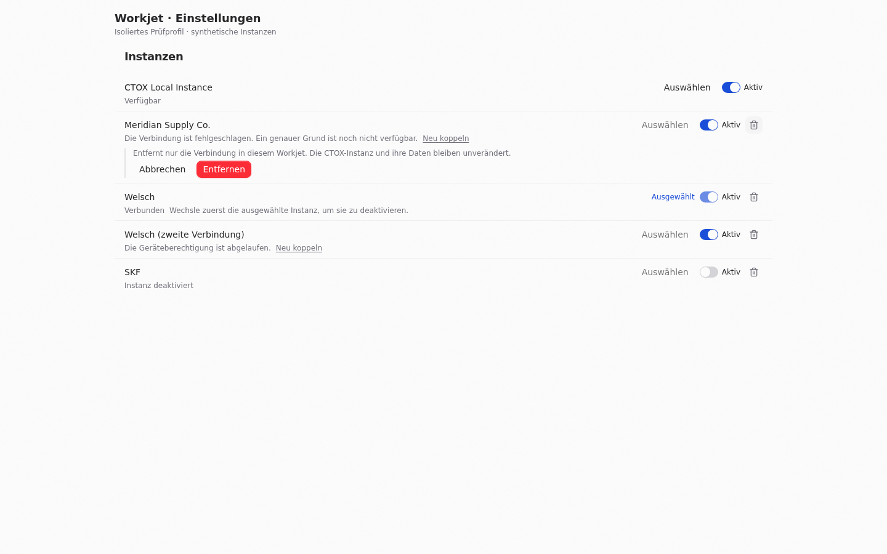
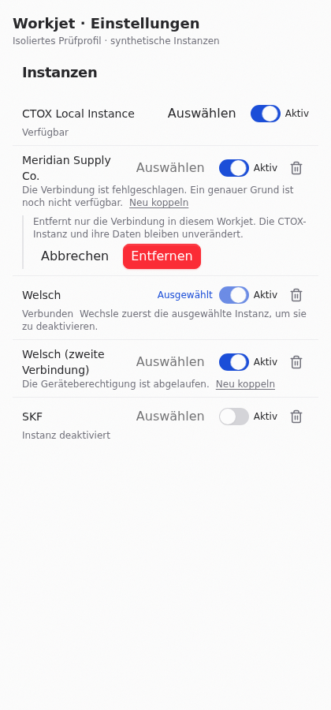

# Instance activity and removal — 2026-10-11

PR: https://github.com/metric-space-ai/workjet/pull/415

Settings previously offered selection and paired-instance unlinking. There was no persisted per-instance activity policy and no local hide/restore path for managed instances.

`CtoxInstancePreferences` stores only public instance descriptors and `enabled` / `disabled` / `removed` in the desktop registry directory. Discovery retains the marker. Activity changes use the cached descriptor instead of running discovery. A stop marker is written before pooled guests are closed. Admission guards cover guest preparation, managed launch, paired/local/SSH resolution and shell-fleet checks. Local and SSH discovery retain the descriptor without network probes while disabled or removed.

The Instances table uses the shared switch, separate Selected label, quiet state/reason text and inline removal confirmation. The local instance has no trash. Managed removal is a local marker; Add instance restores it. Paired removal invokes the existing `removePairedInstance` path and existing session cleanup. Re-importing a pairing or SSH connection restores its activity. No project, thread or worktree deletion is called.

The selected-instance guard is checked in the UI against the live selection and in IPC against its submitted selection snapshot. Activity state is persisted by the desktop; it is not a React-only setting.

Registry overlap with `codex/safe-storage-key-loss-recovery`: the import of preferences, local/SSH probe options, launch-resolution admission checks and final discovery merge are touched. Pairing document formats, encryption, damaged-secret recovery, and `removePairedInstance` are unchanged.

The isolated UI run `workjet-instance-enable-remove-20261011T085916Z` passed at 1440 and 420 px: selection lock, no local trash, inline confirmation, no horizontal overflow, disable/reload/enable, managed removal/reload and paired removal. The shared switch now keeps its instance-specific accessible name; a wrapping implicit label previously replaced that name with only “Aktiv”. The retained-project status is tested in German and English. Earlier regression coverage passed 218 desktop, 121 web and 36 contract tests. The final-head commands and receipt are reported in PR #415. Installed-product acceptance remains with the supervisor after merge.





Verification commands on gpu3, with two workers:

```sh
pnpm exec vp check
pnpm exec vp run typecheck
(cd apps/desktop && pnpm exec vp test run --maxWorkers 2 src/ctox/CtoxShellFleet.test.ts src/ctox/CtoxManagedLaunch.test.ts src/ctox/CtoxInstancePreferences.test.ts src/ctox/CtoxGuestManager.test.ts src/ctox/CtoxInstanceRegistry.test.ts src/ctox/CtoxSshManagedSource.test.ts src/ctox/CtoxLocalDaemonSource.test.ts src/ipc/methods/ctox.test.ts)
(cd apps/web && pnpm exec vp test run --project unit --maxWorkers 2 src/components/settings/InstancesTable.test.tsx src/components/settings/BusinessOsSettings.test.tsx src/components/ctox/CtoxModeShell.test.tsx src/localProjectRegistration.test.tsx src/workjetProjectCreation.test.ts src/workjetSupervisorControl.test.ts src/workjetProjectControl.test.ts)
(cd packages/contracts && pnpm exec vp test run --maxWorkers 2 src/ctox.test.ts src/ctoxProjectDiagnostic.test.ts src/workjetSupervisor.test.ts)
node scripts/audit-workjet-content.mjs
```

The registry/service restart test checks an isolated SQLite file byte-for-byte and reads back its retained project and thread. Admission tests assert no authentication refresh, launch or view creation for disabled/removed instances. Probe counters remain zero for disabled local and SSH targets. The selected instance cannot be disabled; local removal is rejected in IPC. Re-enabling persists first and reconnects through the existing pairing path.

The public discovery descriptor does not supply a diagnostic stage for a generic `error` status. The row states that the exact cause is unavailable instead of inventing one; offline, expired device permission and missing sign-in are explained when known. The source registry’s key-loss recovery and secret formats are unchanged.

All owned browser/server children were stopped and the temporary UI entry removed; see [cleanup](instance-enable-remove-20261011/cleanup.json). No Mac lease was used.

Screenshot scope: the production `InstancesTable` and shared settings section, served in an isolated browser profile on gpu3 with synthetic public descriptors and a file-backed callback. Native persistence and connection suppression are tested separately. No installed app data, credentials, keychain or safeStorage helper is used.
