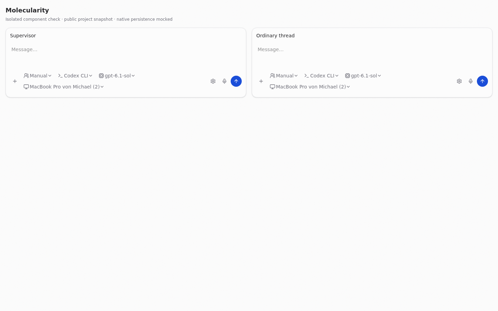
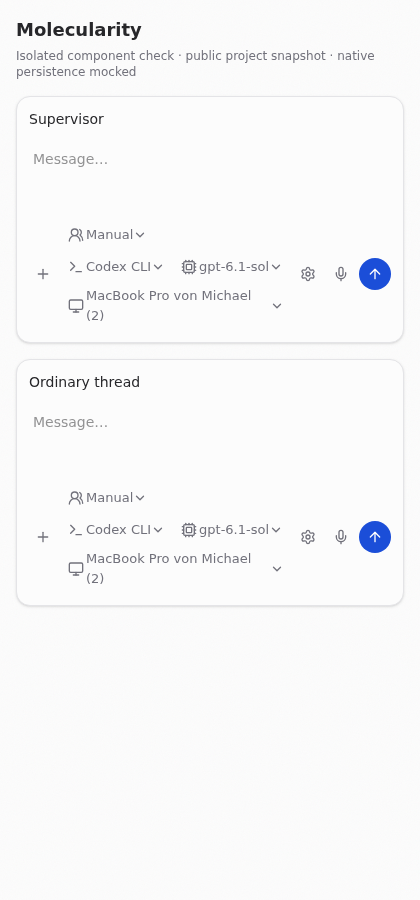

# Supervisor normal composer — 2026-10-11

Owner: `01a1227e-c0ad-7950-9446-ef5dc0797e90`. PR: https://github.com/metric-space-ai/workjet/pull/402. Base: `4b376c7458d790269fe02f6ed5d0afe68acd00c8`. The operator start-tool order was canceled before source changes; this PR contains only the supervisor composer repair.

## Cause

`NativeSupervisorRouteControls.tsx` previously rendered its own two selects for instance Luma/model and separate project-instance/configuration controls. It could select an existing Luma, but it could not express Manual harness/model/computer choices. `NativeSupervisorComposer.tsx` put the task mode and worker-access control into the bar; `NativeWorkerSourceControl.tsx` rendered a renew-access button even for a healthy binding.

The ordinary bar already used `ComposerWorkerControl`, `ComposerManualTargetControls` and `ComposerComputerControl`. The supervisor now uses those exact components inside `ComposerBar`. It reads the project's instance-owned Luma and configured route, without presenting the local thread's `modelSelection` as the native route.

## Persistence and connection

`supervisorComposerSelection.ts` uses the existing instance Luma configuration RPC with revision checks, then reads the configuration back, sends the existing correlated `project.configure` request with `supervisorLumaId`, and reads the project registry back. A choice is accepted only when both read-backs agree. Configuration conflicts, scope changes and missing account routes fail explicitly. No message needs to be sent to save a selection.

Manual creates an immutable project-owned Luma, reusing the same combination if it already exists. It preserves the configured account route for the selected model and does not modify shared Lumas. If a catalog-advertised account has no configured route yet, the same revision-checked write creates the route and project Luma together; read-back also checks the account reference. No account or credential is created. The existing native supervisor dispatcher resolves the saved project Luma for a new request; this PR adds no parallel dispatcher or credential path.

Automatic provisioning/binding is retained. The worker connection component runs headlessly and supplies a typed recovery status. The parent renders one quiet connection row over the editor, with one sign-in/reconnect action. The task mode moves into the gear menu; the renew-access and refresh-task buttons are removed. Dictation, submission receipts, public replies and existing-task continuation remain on their existing paths.

## Evidence scope

The comparison uses production controls and styles with a read-only public Molecularity snapshot from the installed app: project title/IDs, thread model selection, configured Luma facts, and computer labels/harness availability. It excludes protected authentication files, credentials, instructions and personalization. The installed app and its userdata were not modified.

The isolated browser's native configuration/project RPC is a mock. Its save/reload result proves the composer persistence flow against that mock, not successful native execution in the installed app. Installed native route adoption and first-response acceptance remain for the supervisor after merge/install. No live supervisor turn or login was performed.

Browser lane `workjet-supervisor-normal-composer-20261011T045629Z` passed on `ec15a7f0dcfc17eba200b81962c7ef8db2841584`: 89 tests and the comparison with harness/model selection, configuration write, project write, read-back, reload, and retained chips. Component blob IDs are recorded in [source.json](supervisor-normal-composer-20261011/source.json); the pictured components are unchanged on the PR head. [proof.json](supervisor-normal-composer-20261011/proof.json) records zero browser errors and, at 420 px, document width 420 px and each bar 362 px with scroll width 362 px. [cleanup.json](supervisor-normal-composer-20261011/cleanup.json) confirms both owned processes stopped and temporary entries removed.

| State                                                | 1440 px                                                                      | 420 px                                                                      |
| ---------------------------------------------------- | ---------------------------------------------------------------------------- | --------------------------------------------------------------------------- |
| Manual; Codex CLI and the stored public thread model | [Comparison](supervisor-normal-composer-20261011/supervisor-normal-1440.png) | [Comparison](supervisor-normal-composer-20261011/supervisor-normal-420.png) |
| Saved harness/model switch and reload, isolated mock | [Comparison](supervisor-normal-composer-20261011/supervisor-saved-1440.png)  | [Comparison](supervisor-normal-composer-20261011/supervisor-saved-420.png)  |

The first two UI attempts failed in the temporary browser setup before rendering. They were not recorded as product failures or acceptance passes. Every attempt completed its owned cleanup. The successful run uses an isolated router and the existing web package dependencies; no debug entry or mock server ships in the application.

Required final commands are `pnpm exec vp check`, `pnpm exec vp run typecheck`, the affected unit tests, and `node scripts/audit-workjet-content.mjs`. The final head and canonical lane receipt are recorded in the PR and in the durable owner evidence `~/.codex/task-evidence/composer-bar-restore-20261009/supervisor-normal-composer-20261011/final-validation.json` after the run. That external record does not alter the tested commit.

## Scope and resources

No file owned by overview PR #393 is changed. No contract or native dispatch implementation is changed. Web/desktop share this composer; mobile has no native supervisor composer implementation in this PR. No provider adapter changes are needed because the existing native Luma route contract carries the harness/model/computer selection.

Linux tests/browser checks run through the canonical gpu3 lane with two CPUs/workers and task `workjet-supervisor-normal-composer`. The browser and Vite process are owned by that bounded lane unit; its finalizer stops both and removes the temporary comparison entry. No Mac lease, installed-app changes, logins or keychain operations are used. PR remains unmerged for Claude.
